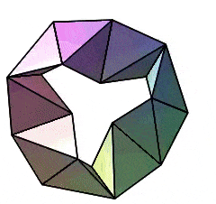
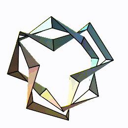
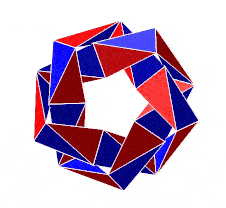
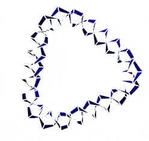
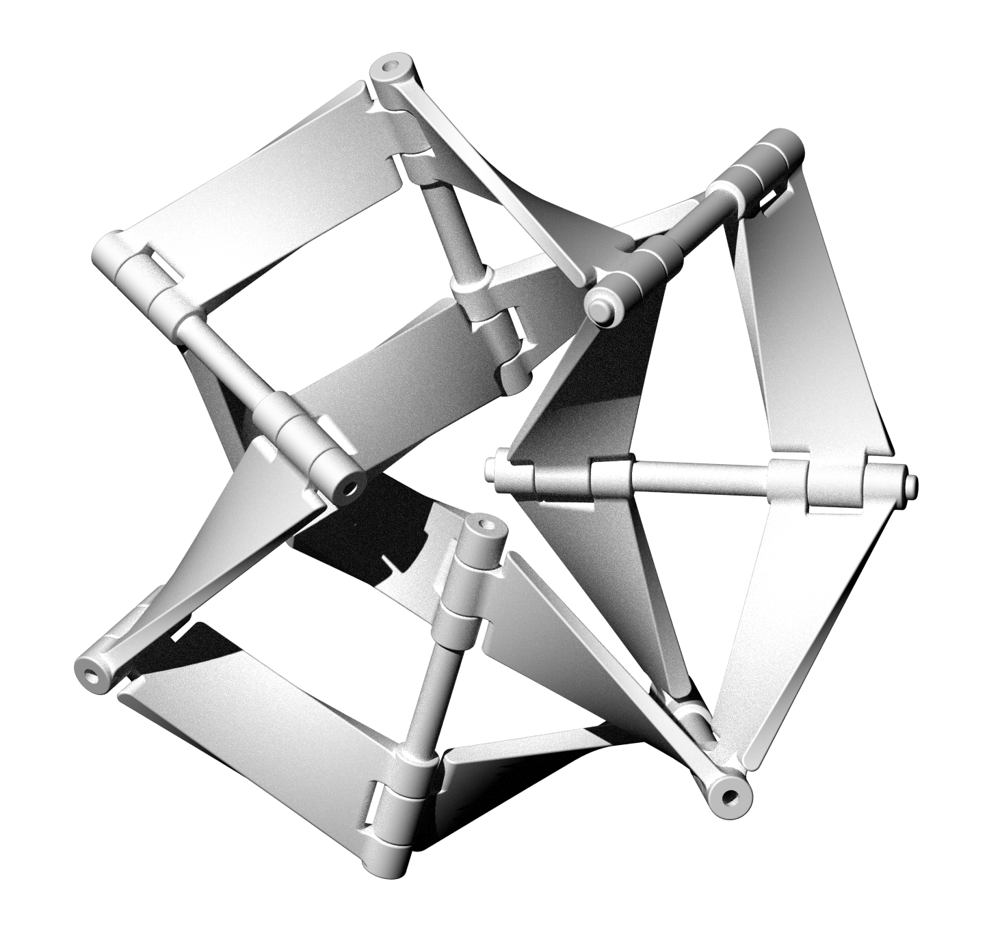
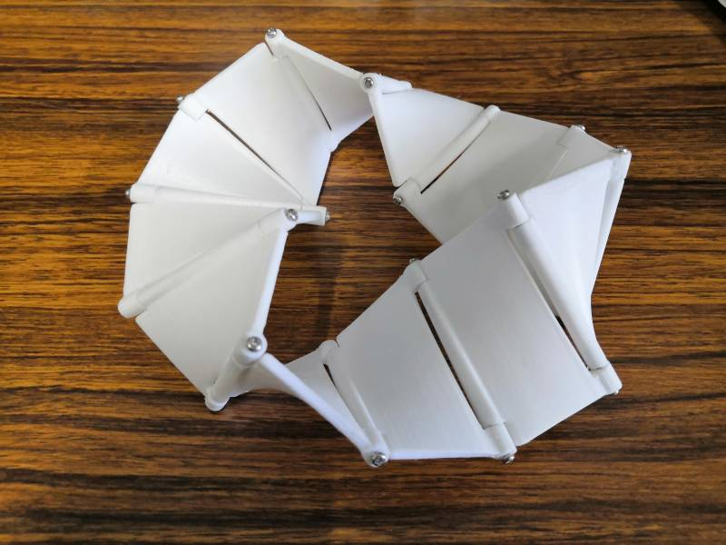
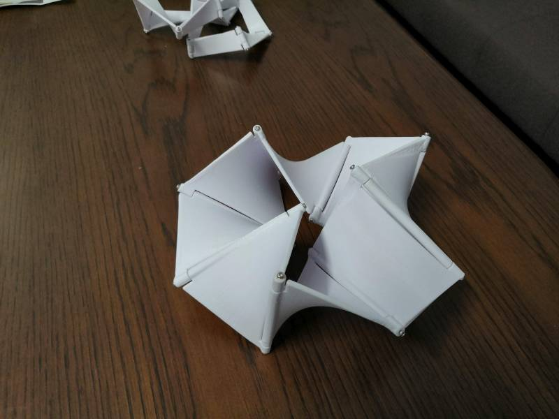
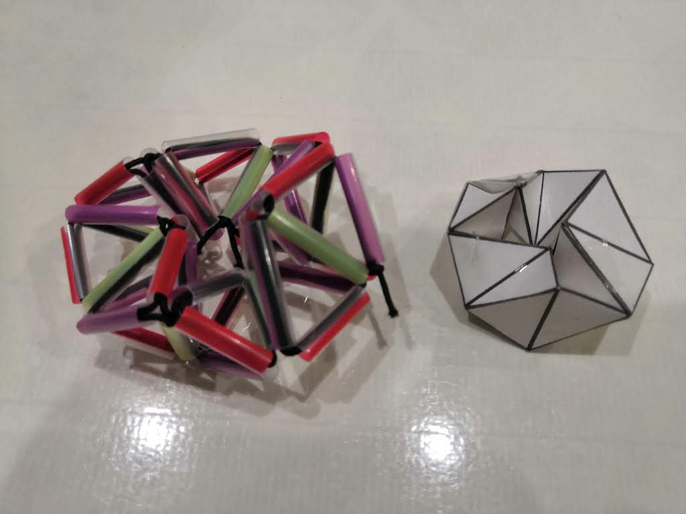
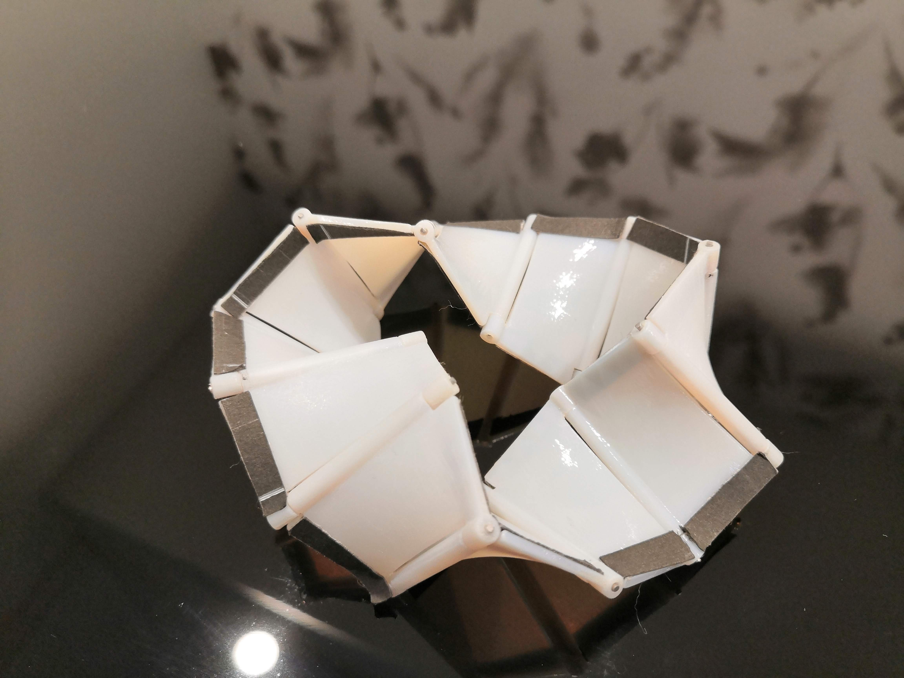

[English](README.md) | [日本語](README.ja.md)

# Kaleidocycle: Geometry of Closed Linkages

Kaleidocycles are closed linkage mechanisms shaped like discrete Möbius bands.
Each unit consists of tetrahedral links that flip inside-out by rotating around
hinged joints, producing everting motions reminiscent of bubble rings. This
repository gathers the assets needed to model, simulate, and fabricate these
mechanisms: Python tooling, Maple/Mathematica notebooks,
paper templates, and 3D-printable parts.

**[Interactive demo!](https://shizuo-kaji.github.io/Kaleidocycle/)**

## Contents
- [Repository Tour](#repository-tour)
- [Documentation](#documentation)
- [Quick Start](#quick-start)
- [References & Further Reading](#references--further-reading)
- [Patent](#patent)
- [Gallery](#gallery)
- [License](#license)

## Interactive demo

**[Open Kaleidocycle Studio](https://shizuo-kaji.github.io/Kaleidocycle/)**

The studio runs the animation by mKdV hierarchy and semi-discrete sine–Gordon flows,
and supports interactive editing of vertex positions and torsion-angles.

## Repository Tour
- [`python/`](python/) — Python scripts (package sources under
  `src/kaleidocycle/`, notebooks, examples)
- [`obsolete_maple_mathematica/`](obsolete_maple_mathematica/) — legacy
  [`Kaleidocycle.mw`](obsolete_maple_mathematica/Kaleidocycle.mw) (Maple) and
  [`Kaleidocycle.nb`](obsolete_maple_mathematica/Kaleidocycle.nb) (Mathematica)
  scripts for symbolic construction, visualization, and template export
- [`3d_model/`](3d_model/) — STL for 3D printing
  (models by [Kamagata Design Studio](https://kdstudio.jp/))
- [`paper_model/`](paper_model/) — printable templates for hand-folded models
- [`LICENSE`](LICENSE) — MIT license for the code (see the patent note below)

## Documentation
- [Python toolkit](python/README.md) ([日本語](python/README.ja.md)) —
  installation, notebooks, exact constructions, integrable deformations,
  rigidity analysis and CAD export
- [Kaleidocycle Studio](python/web/README.md) — the browser studio: integrable
  flows, constrained editing, Model lab and analysis plots
- [Python API reference](python/api.md) — the integrable-deformation API and
  the inventory of legacy routines
- [3D-printable models](3d_model/README.md) and
  [paper models](paper_model/README.md)

## Quick Start
### Python toolkit
1. `cd python`
2. `uv venv .venv && source .venv/bin/activate`
3. `uv pip install -e ".[dev]"`
4. `pytest` (or `pytest -k geometry`) to run the suite
5. `jupyter lab notebooks/FindKaleidocycles.ipynb` for interactive exploration

See the [Python toolkit README](python/README.md) for details.

### Maple / Mathematica
Open `obsolete_maple_mathematica/Kaleidocycle.mw` (Maple) or
`obsolete_maple_mathematica/Kaleidocycle.nb` (Mathematica) to reproduce
symbolic computations. Both scripts include visualization helpers
and export functions for paper templates and motion studies.

### Physical model assets
- Print STL files from `3d_model/` to fabricate kaleidocycles
- Use `paper_model/` templates and folding instructions for hand-folded
  prototypes

## References & Further Reading
### Technical publications
- Shizuo Kaji, Kenji Kajiwara, Shota Shigetomi,
  [*An explicit construction of Kaleidocycles by elliptic theta functions*](https://doi.org/10.1111/sapm.70224),
  Studies in Applied Mathematics, 156, no. 5 (2026): e70224, [arXiv:2308.04977](https://arxiv.org/abs/2308.04977)
- Shizuo Kaji, Kenji Kajiwara, Hyeongki Park,
  [*Linkage Mechanisms Governed by Integrable Deformations of Discrete Space Curves*](https://arxiv.org/abs/1903.06360),
  in *Nonlinear Systems and Their Remarkable Mathematical Structures*, Vol. 2,
  CRC Press, 2019
- Shizuo Kaji,
  [*A closed linkage mechanism having the shape of a discrete Möbius strip*](https://arxiv.org/abs/1909.02885),
  JSPE Spring Meeting Symposium, 17 Mar 2018

<!-- ### Talks, slides, and abstracts
- (slides) [*Geometry of Kaleidocycles*](https://www.math.kyoto-u.ac.jp/~kaji/papers/Kaleidocycle21.pdf),
  Kyushu-Illinois Strategic Partnership Colloquia Series #2, 11 Mar 2021
- (slides, Japanese) [*Kaleidocycle*](https://www.math.kyoto-u.ac.jp/~kaji/papers/ShapeDesign.pdf),
  13 Mar 2021
- Shizuo Kaji, Eliot Fried, Michael Grunwald, Johannes Schoenke,
  [*Geometry of closed kinematic chain*](https://www.math.kyoto-u.ac.jp/~kaji/files/Kaleidocycle17.pdf),
  IMI Workshop on Mathematics in Interface, Dislocation and Structure of
  Crystals, 29 Aug 2017 -->

### Japanese-language articles
- プレスリリース:
  [現代数学と折紙から生まれた新しい機構「メビウス・カライドサイクル」](https://www.kyushu-u.ac.jp/ja/researches/view/908)
- プレスリリース:
  [任意個数の四面体に対してカライドサイクルの存在を数学的に証明](https://www.kyoto-u.ac.jp/ja/research-news/2026-05-19-3)
- 鍛冶静雄, [動く折り紙「カライドサイクル」をめぐる機構学と幾何学の出会い](https://www.math.kyoto-u.ac.jp/alumni/bulletin9/kaji.pdf), 京都大学数学教室同窓会誌, Vol 9, 2025
- 鍛冶静雄,[ユークリッド空間への図形の配置と設計への応用](https://www.mathsoc.jp/assets/pdf/publications/sugaku/sugaku78-3hyoushi.pdf), 雑誌「数学」第78巻 第3号, 2026
- 鍛冶静雄,
  [曲線の幾何学から生まれた閉リンク機構](https://drive.google.com/file/d/1CtwQHpcM_HEn3ooKfJ5y40s_B99IqRwR/view?usp=sharing),
  2018年度精密工学会春季大会 シンポジウム資料集, pp. 62–65
- 鍛冶静雄,
  [数理のクロスロード／かたちと動きの数理基盤／(1) リンク万華鏡](https://drive.google.com/file/d/1OzZajghUbhxeA3HFf4-TjSBeRZROcfiD/view?usp=sharing),
  数学セミナー 2019年6月号, 日本評論社
- 鍛冶静雄,
  [かたちを算する／おもちゃのかたち](https://www.nippyo.co.jp/shop/magazine/8418.html),
  数学セミナー 2021年1月号, 日本評論社

## Patent
The specific shape of the Möbius kaleidocycle is covered by the patent
* Shizuo Kaji, Johannes Schoenke, Eliot Fried, Michael Grunwald,
  [*Moebius Kaleidocycle*](https://patentscope2.wipo.int/search/en/detail.jsf?docId=WO2019167941),
  JP2018-033395 (Japan), 2019JP007314 (PCT), WO 2019167941, filed 27 Feb 2018.

However, feel free to use the material here for personal and educational projects.
For commercial use, contact the [Japan Science and Technology Agency](https://www.jst.go.jp/chizai/en/).

Some of the results described above are also published in
- Johannes Schoenke and Eliot Fried,
  [*Single degree of freedom everting ring linkages with nonorientable topology*](https://www.pnas.org/content/116/1/90.abstract),
  *PNAS* 116 (1), 90–95, 2019

## Gallery

## License
All code and assets in this repository are released under the MIT License (see
[`LICENSE`](LICENSE)). Cite the references above when using or extending the
material in academic work.
